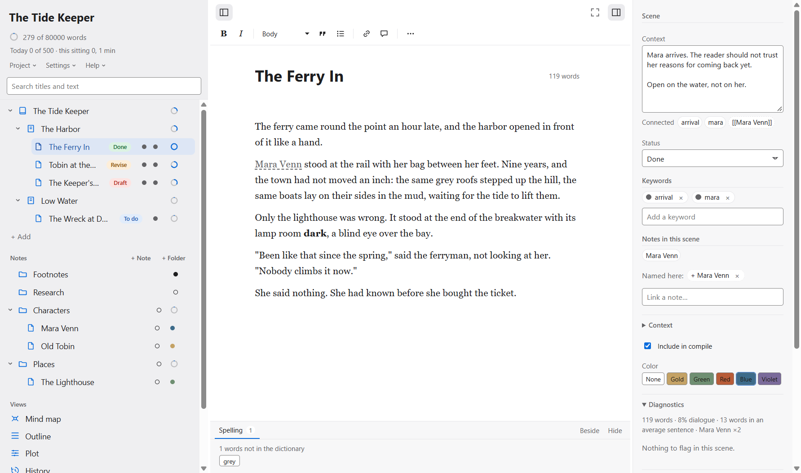
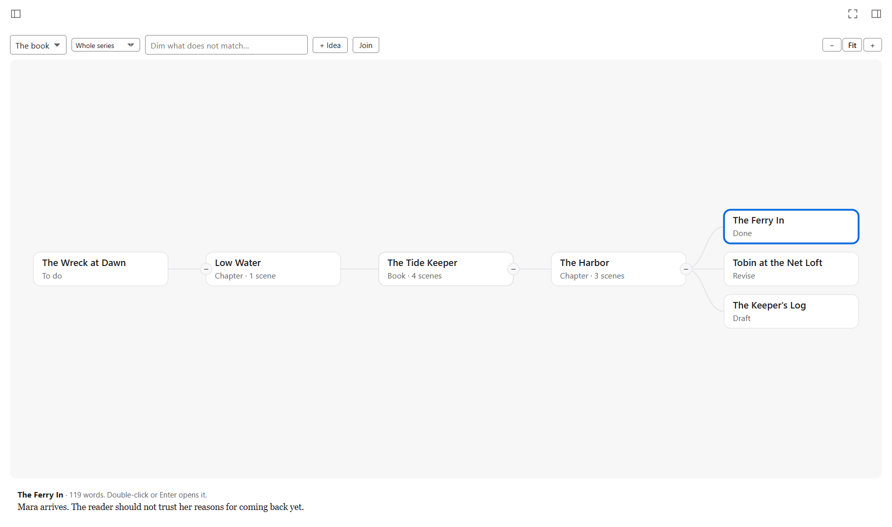

# Writing Studio

A free, open-source writing app for novels and series. Plan the book, write it scene by scene, and compile it, all on your own computer. No account is needed, and nothing leaves your machine unless you choose to sync.



## What you can do

- **Write in Markdown that reads like a book.** The page shows bold as bold and a heading as a heading, and shows the marks only where the caret is. You choose the font, line length, and spacing, and there is a focus mode.
- **Organize the book.** Books, parts, chapters, and scenes go in a library you rearrange by dragging. Each scene has a status, keywords, and a ring that fills as it gets done. You can also see the book as a mind map or as an outline.
- **Keep notes beside the book.** Notes for characters, places, research, or anything else, in folders you make, written freely and linked from the text with `[[links]]`.
- **Give every level its context.** Each scene, chapter, part, and book has a free text for what it is for and what the reader should not know yet. It is kept at the top of its file, so an AI reading the project reads it first, and **Copy context** puts a whole level's context on the clipboard.
- **Revise.** Notes and highlights on the text, tracked changes, spellcheck, snapshots to compare, and counts and checks on each scene.
- **Keep track.** Daily and book word targets, a deadline with the pace that meets it, and saved filters.
- **Never lose work.** Autosave, snapshots, and backups. Each scene is a plain Markdown file that any Markdown or text editor can open.
- **Compile.** Export a book as Word (DOCX), an ebook (EPUB), a web page (HTML), or Markdown, with a title page, contents, footnotes, and the rest of the front and back matter.
- **Sync if you want to.** Keep a project on several computers through git, with any host you choose. Writing never needs it.

Every feature is listed in [documentation/features.md](documentation/features.md).



## Download

Writing Studio runs on **Windows 10 and 11** and on **Debian and Ubuntu**.

Packages are published on the [Releases page](https://github.com/jjdias/writing-studio/releases) with each version:

| System | File | How |
| --- | --- | --- |
| Windows | `WritingStudio_<version>_x64_en-US.msi` | Installs it, with a Start menu entry. Remove it from Settings → Apps. |
| Windows | `Writing-Studio-windows-x64-portable.zip` | Unzip it anywhere and open `Writing Studio.exe`. Nothing is installed. |
| Debian, Ubuntu | `WritingStudio_<version>_amd64.deb` | `sudo apt install ./WritingStudio_*_amd64.deb` |

`SHA256SUMS.txt` on each release lists every file's checksum.

**The first release, `v0.1.0`, is not out yet.** Until then, the latest packages built from `master` are on the [Package workflow's runs](https://github.com/jjdias/writing-studio/actions/workflows/package.yml?query=branch%3Amaster+is%3Asuccess). Open the newest run, and download `packages-windows-latest` or `packages-ubuntu-latest` under **Artifacts**. GitHub asks you to sign in to download them, and keeps them for a limited time.

The Windows installer is not signed yet, so Windows may say it "protected your PC". Choose **More info**, then **Run anyway**. Sync between computers needs [git](https://git-scm.com/) installed; writing and compiling do not.

## Build from source

You need:

- [Rust](https://www.rust-lang.org/tools/install), stable, 1.80 or later.
- On Windows, the [Microsoft C++ Build Tools](https://visualstudio.microsoft.com/visual-cpp-build-tools/) and WebView2, which Windows 10 and 11 already have.
- On Linux, WebKitGTK and GTK 3 with their headers. On Debian or Ubuntu: `sudo apt install libwebkit2gtk-4.1-dev libgtk-3-dev libxdo-dev libayatana-appindicator3-dev`

Then run:

```bash
cargo run -p writing-studio-desktop
```

On the welcome screen, give the project a title, choose **New project**, and pick where its folder goes, outside any other project. Writing Studio makes a `YourTitle.writingstudio` folder there. Add a chapter and a scene, and start writing. Press **Ctrl+/** at any time to see every shortcut.

## Learn more

- [Every feature](documentation/features.md), in one list
- [Using Writing Studio](documentation/USAGE.md), step by step
- [Sync between computers](documentation/SYNC.md)
- [How a project is stored](documentation/PROJECT_FORMAT.md)
- For contributors: [architecture](documentation/ARCHITECTURE.md) and [releasing](documentation/RELEASING.md)

## License

MIT OR Apache-2.0, at your choice: [LICENSE-MIT](LICENSE-MIT) and [LICENSE-APACHE](LICENSE-APACHE). Use, study, change, and share it. Each package has a `licenses` folder with these, the dictionary's license, the Markdown editor's (CodeMirror 6), and a notice of every library the program is built from. It sits beside the program on Windows, and in `/usr/lib/WritingStudio/licenses` on Linux.

Spellcheck uses the `spellbook` crate (MPL-2.0) and bundles the Hunspell English (US) dictionary, which has its own permissive license: see [`crates/spellcheck/dictionaries/`](crates/spellcheck/dictionaries/README.md).
